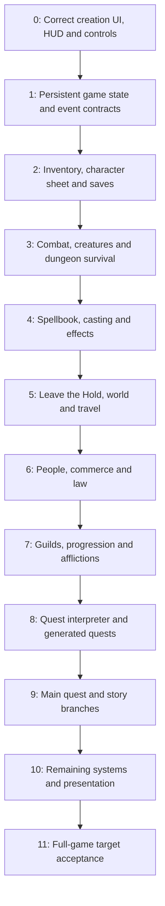

# OGFALL: from Privateer's Hold to the full game

Status: 2026-11-08, playable Privateer's Hold slice; full-game work remains.
Character creation, classic controls/HUD, Options, readable preferences, key
bindings, inventory/equipment, the character sheet, spellbook item, books and
dungeon loot are implemented. Combat includes melee, fists, bows/arrows,
creature pursuit/attack animations, injuries, death recovery and persistent
lootable corpses. Rest/loiter and hourly recovery are implemented. Six-slot
save/load uses schema 4 and upgrades schemas 2/3; DOS saves are out of scope.
The user has exercised saving/loading and reported improved audio on the target.
The latest fixes are host-tested; the full target checklist remains open.
Implementation details and verification are in [ogfall.md](ogfall.md).

## What is still missing

This is OGFALL's checklist. Features already present in GFALL do not count as
implemented here. Follow the original rules in the byte-matched decompilation
when completing each system.

### Inventory completed; remaining system integrations

The current inventory interactions and ordinary-item descriptions are complete
and host-tested; see [the source audit and tests](ogfall.md#inventory-completion-2026-11-08).
The earlier quantity-splitting entry was an incorrect assumption: original
inventory actions move whole items/stacks. Taking arrows merges into one carried
stack capped at 199, discarding overflow as `inv_merge_arrows` does. Gold keeps
its numeric amount prompt. No invented general split-stack dialog is needed.

Spellbook rename, icon cycling, subtype labels, effect help, paging, scrollbar,
reordering and deletion now work on owned, saved records. Original SORT artwork
has no button handler. Casting costs/list prefixes and ready/cast behavior
belong to the upcoming magic rules, alongside the item effects below.

- **Character sheet:** skill-use progression, level advancement, the written
  biography, live affiliations and quest-log contents remain. History currently
  shows creation/reputation information; guild and quest buttons report an empty
  state until those systems exist.
- **Loot coverage:** MAGIC.DEF enchantments, potions/recipes and specialized
  descriptions/effects remain. Mundane corpse loot and generated creature gear
  are implemented. Original book rarity selection is implemented. Random markers share
  picture 216/0; their original appearance/probability rules need completing.
  Mundane treasure, persistent empty containers and dropped piles already work.
- **Scale:** initial empty treasure rolls have a 32-attempt limit and objects
  use a bounded 256-record pool. Revisit those limits with larger places and
  real object populations rather than treating the Hold slice as full-world
  coverage.

### Systems still to implement

- **Combat and survival:** original sensing, wall-following, fleeing, teams and
  inter-creature combat; complete human/guard initialization, enchantment strike
  effects, creature spells, poison/disease attacks and knockback collision damage.
  Finish rest encounters, six-hour skill advancement, swimming/breath/drowning,
  climbing and other survival rules. The original death movie is not played.
- **Magic:** ready/cast/recast/abort, costs, projectiles, effects and durations,
  spell making and purchasing, magical-item use, potions and enchanting. The
  spellbook is currently the item and its contents, not working spell casting.
- **Maps and travel:** dungeon/town automaps, leaving the Hold, other places,
  streamed wilderness, towns and building interiors, travel map and journeys,
  horses, carts and wagon storage. The inventory's Wagon button is a notice.
- **Other HUD/actions:** map, travel, transport, magic-item use and status
  still need their gameplay/screens connected; a click sound alone does not
  mean an action works. Quest log and notebook also need their systems.
- **People and law:** dialogue, trade, shops, banking, stealing/pickpocketing,
  lockpicking rules, guards, crimes, trials and imprisonment. Talk/Steal mode
  selection currently changes the mode and icon, not these systems.
- **Progression and conditions:** guild membership/services/ranks, reputation
  consequences, training, diseases, poisons, vampirism and lycanthropy, with the
  original time and recovery rules.
- **Quests and story:** quest interpreter, resources, events and deadlines,
  generated quests, main-quest branches, journal integration, and opening/ending
  presentation. Readable item books are implemented; the opening movie is skipped.
- **Settings and presentation:** Detail is deliberately stored without changing
  rendering yet. Joystick control is unsupported. Complete sound/music/event
  coverage as the remaining systems arrive.
- **Persistence:** extend OGFALL's own save schema alongside each new system.
  Existing saves live in `ogfall/saves`; preferences and bindings live in
  `ogfall/settings.cfg`. DOS-save compatibility is not required.

### Target playtest still needed

Target reports drove corrections to UI sound IDs, hand-specific equipment,
pile activation, humanoid combat variants, bat flight and positional sounds.
The latest audio was reported as improved; continue verifying the complete
new-game-to-death/save/load loop on the target. See the dated follow-up sections
in [the implementation notes](ogfall.md).

Use `build/gfall.iso` and run OGFALL.EXE. The latest `make all`, host suite,
fresh-process restore and Win98 binary/stack-probe checks pass, but composed
host images do not establish Glide appearance, input behavior or target speed.

- [ ] Creation: class scrollbar, reflex-help parchment, typed name and OK.
- [ ] Movement/HUD: bottom alignment, original direction cursors, passive hover,
      left-button steering, forward-right, vertical look, Cursor/View changes.
- [ ] Options: volume, head bob, fullscreen/HUD, binding changes and persistence
      after exiting and restarting. Inspect the readable settings file.
- [ ] Inventory: F6/HUD pack, tabs, scrolling, paper-doll selection, equip/remove,
      clothing styles, item information, gold amount and carry-limit rejection.
- [ ] Completion: worn items leave the pack list, Equip takes and equips loot,
      books can be read in the searched container, paintings show their image
      and caption, cloaks draw behind the body, arrows merge up to 199.
- [ ] Follow-up: UI clicks sound like clicks; F5/F6 open silently; books retain
      their opening/page sounds. Two one-handed swords appear in separate hands
      and each can be clicked off; a two-handed weapon clears the other hand.
- [ ] Sheet: F5/portrait, name, attributes, all four skill groups and scrolling.
- [ ] Spellbook: open through Use and its shortcuts, reorder/delete, store the
      book and recover it; contents must remain attached to that same book.
- [ ] Spellbook completion: rename, left/right icon cycling, effect/subtype
      help and its Page Up/Down, dragging/repeating scrollbar controls, and
      edited names/icons after a restart. Delete is immediate in the original.
- [ ] Books: multiple titles, page arrows, Page Up/Down, Go To Page, sound and
      returning to inventory; check text clipping and parchment on the card.
- [ ] Treasure: activate within reach, reject through-wall activation, empty and
      reopen without a reroll, drop/take items and gold, remove an emptied pile.
- [ ] Combat: both hands, six swing directions, bows/ammunition, damage and
      equipment wear; humanoids retain their sex through hurt and shooting poses.
- [ ] Flight/audio: bats stay on the correct storey around stairs; voices, hits,
      arrows and corpse falls attenuate with distance and walls.
- [ ] Rest: campfire and key, timed rest, until healed, loiter, Stop/Escape,
      nearby-enemy rejection, recovery totals and saved elapsed game time.
- [ ] Death: Load, cancel loading, return to title/new game with no saves, Quit;
      dead saves cannot be written and older dead saves fail with an explanation.
- [ ] Save/restart/load: preserve equipment, styles, names, quantities, gold,
      spell order/deletions, emptied treasure, dropped piles, position and doors.
- [ ] Repeated screen changes, saves/loads, focus changes and a longer session:
      no stuck input, crashes, growing memory use or degraded frame rate.

Measure RAM/VRAM use, loading time and frame rate on the MMX 233/Voodoo 1 as
content grows. Full-game performance and long-session stability remain open.
Address target regressions first, finish dungeon survival/combat, then implement
casting and effects before extending the playable world beyond the Hold.

### Engineering follow-up

- Split the large app adapter and character-creation controller by responsibility
  while preserving their source-derived behavior and existing interaction tests.
- Reduce remaining duplicate selections between the borrowed place builder and
  OGFALL rules; sprite variants now have one source, the selected walking archive.
- Measure RAM/VRAM, loading and crowded combat on the target before increasing
  object limits, place size or eager combat-art loading.
- Extend the save schema and fresh-process tests with each new persistent system.

## Objective and authority

Reproduce Daggerfall 1.07.213's game behavior on the existing Win98/Glide engine,
using `/home/shade/git/daggerfall-decomp` as the source for original rules,
control flow, UI geometry, data layout and event order. Its byte-matched output
is a much stronger reference than a second implementation. This does not make
OGFALL a byte-matched executable or make the translated C pointer casts portable.

Use `src/hand` and `src/lifted` together, resolving names through `config/names.csv`
and `config/symbols.txt`. When a lifted expression, sign, pointer or unit is
ambiguous, check the matching original instruction and run the original game.
Do not use the older `daggerfall/decompiled` tree as authority. DFU-derived
shared readers are useful infrastructure; their gameplay interpretations do not
settle disagreements with FALL.EXE.

Keep the engine responsible for Glide, platform input, generic collision,
geometry, sound output and resource budgets. OGFALL owns the player, time-driven
rules, objects, screens, interactions and quests. Adapt XnGine calls at that
boundary; do not import XnGine's renderer or DOS platform implementation.

## Milestone 0 — correct the baseline reported on the target

All five reports are release blockers for this milestone. Preserve the HUD's
working art and fix its placement and input geometry.

1. **Class-list scrollbar.** `paint_class_list` currently paints the window and
   rows without a movable thumb. Reproduce `support.c`'s `list_popup_open` and
   `picklist.c`'s track/thumb calculation, arrows, held repeat, page clicks and
   dragging. Give the custom-class skill/special pickers the same list widget.
   Check empty/short/exactly-full/overflowing lists, first and last rows, and
   double-click acceptance. Acceptance: reach Custom by mouse, drag back to Mage,
   and see the highlight, thumb and selected class agree.
2. **Parchment behind reflex help.** `paint_reflex` currently draws TEXT.RSC 307
   directly over the map. Reproduce the message-box border style, wrapping,
   background, placement flags and lifetime used by `generate.c` and
   `msgbox_render` (`src/hand/func_0003DCF4.c`, `src/lifted/text.c`). This is a
   reusable message-box primitive, including the original positioning around
   the reflex selector. Acceptance: readable text entirely on the correct
   parchment; no overlap with the selector or OK; screenshot compared to FALL.EXE.
3. **HUD and mouse schemes.** The HUD currently uses the menu's centered
   320x200 letterbox transform, leaving a gap below the bar. Establish separate
   menu, world-view and bottom-anchored HUD rectangles. Use the same geometry
   for drawing, pointer conversion, hit testing, steering cells and activation
   rays. Audit `hud_draw`, `hud_update`, `intrface_set_regions`,
   `player_mouse_look` and the Cursor/View option before choosing defaults.
   Cursor mode requires the left mouse button for steering; hovering is passive.
   View mode has its own freelook/cursor activation behavior. Reproduce each scheme and its
   transitions rather than treating all edge steering as correct or deleting
   it globally. Acceptance: the intended scheme feels right on the target,
   the bar meets its intended screen edge, and hovering/clicking the HUD never
   moves the player. Verify both schemes, fullscreen/HUD toggles and focus loss.
4. **Forward-right goes left.** Confirmed in `og_move_frame`: regions 0 and 2
   take the same negative-turn branch. Separate the right-hand branch and
   compare every steering handler with `intrface.c` and the named hand units.
   Acceptance: all nine regions, key combinations and strafes give the right
   displacement and heading; left/right cases mirror each other at several yaws.
5. **Vertical mouse look is inverted.** The current movement code adds the
   platform's downward-positive delta to the engine's upward-positive pitch.
   Translate signs at the boundary and audit horizontal look, recentering,
   limits and Home as well. Acceptance: mouse up looks up, down looks down,
   and toggling schemes does not jump or reverse the camera.

Tests must exercise actual movement/camera results and rendered geometry, not
just return the expected region numbers. Use a flat test scene to isolate sign
errors from dungeon collision. Add hit-test/ray checks at HUD and viewport
boundaries. Capture 640x480 target screenshots and a short repeatable input
sequence for comparison with the original. Keep the existing stack-probe check.

## Dependency order

Each milestone should be split into small changes with a playable scenario.
The contracts and test harness begin early; the diagram orders the playable
milestones, not a requirement to postpone all quest design until milestone 8.
No calendar estimate is assigned before the first few target-accepted slices.

## 1 — establish the game state that later features can keep

Source entry points: `main.c`, `init.c`, `object.c`, `objcode.c`, `objlib.c`,
`keys.c`, `support.c`, `options.c`, `char.c`; `include/records.h` and `docs/state.md`.

- Expand the current small `OgCharacter` into the state original gameplay needs:
  base/current attributes, skill values and uses, class restrictions/specials,
  equipment, vitals, identity, reputations, affiliations, effects and conditions.
- Introduce stable object identities and ownership/container relationships.
  Explicitly map original record IDs to engine entities/usables; never persist
  engine pointers or make a texture/entity slot serve as a game identity.
- Define place identity, global and local clocks, timer units, pause behavior,
  mode/modal ownership, and explicit random-generator state. Separate UI random
  draws from simulations only if the original does; allow recording and replay.
- Establish events for activation, item transfer, hit/kill, elapsed game time,
  NPC meeting, faction contact and spell use, with order checked against callers.
- Finish creation's remaining semantics: racial/class traits, all biography
  effects and history, custom restrictions/costs, real starting inventory and
  spell contents. Do not lose unimplemented fields at the boundary.
- Restore the full original key-action set and saved controls, including F5/F6,
  instead of permanently borrowing unrelated engine actions for OGFALL keys.
  Request a generic engine input addition only if the current API cannot carry it.

Acceptance: two independently created characters retain their complete state;
recorded input and random state replay the same rules outcomes; modal screens
and focus loss do not advance the world or leak input.

## 2 — inventory, character sheet and durable saves

Source entry points: `inven.c` and companion units, `equip.c`, `char.c`, `sheet.c`,
`book.c`, `loadsave.c`, `options.c`, `parse.c`, `kludge.c` starting equipment.

- Build real item/container records: material, condition, weight, stack counts,
  clothing variants, gold, letters of credit, equipment restrictions and slots.
- Implement the original inventory, paper doll, info text, equipping/removing,
  dropping and taking items, corpses/containers, gold transfer and readable books.
- Implement the sheet, skill groups, affiliations/history access and text macros
  needed by these screens. Shared list/message-box primitives come from milestone 0.
- Make title and Options Save/Load functional. Persist IDs, ownership, player,
  place changes, random/time state and movers; restore references after loading.
  Use OGFALL's own versioned saves under `ogfall/saves`, with explicit rejection
  of unsupported versions. DOS Daggerfall save compatibility is out of scope.
- Add each later system to save round trips when introduced, not at the end.

Acceptance: create, equip, move an item to a container, save, quit the process,
reload, and recover identical possessions, vitals, position and opened doors.
A failed write preserves the previous save. No active placeholders on these screens.

## 3 — combat, creatures and a survivable dungeon

Source entry points: `weapons.c`, `damage.c` and companion units, `monster.c`,
`moninit.c`, `click.c`, `steal.c`, `rest.c`, `links.c` and named hand functions.

Built and host-tested on 2026-11-08: active hands and original CIF art,
directional melee/unarmed gestures, hit frames, Speed timing, bows, carried
ammunition, swept/visible arrows, original to-hit/damage/material/armor rules,
weapon and armor wear, creature ASCR attack events, hurt/blood, basic pursuit,
player damage/death recovery and persistent, lootable corpses. Armed creatures
carry the original equipment tiers. A fresh-process title Load test preserves
a real Hold kill and its visible corpse. See docs/ogfall.md, Weapons and dungeon
combat, for source functions, timing adaptations and explicit boundaries.
Target pointer/sprite/sound/performance acceptance remains pending.

The follow-up playtest repairs add drawn-weapon pickups, creature floor/sweep
fixes, positional creature voices, MIDI startup, class confirmation sound,
spellbook underlays and correctly fitted inventory icons. Death offers Load,
title/new game and Quit, with dead saves refused. `tgm` protects vitals and gives
certain reachable hits; spellcasting and breath simulation are still pending.

- Complete original creature sensing, wall-following, teams and fleeing; add
  creature spells and disease/poison/curse hit effects. Direct pursuit and melee
  attacks currently run on engine bodies with original ASCR strike events.
- Finish enchantment/artifact strike effects, collision damage from knockback,
  original human/guard special initialization and the original death movie.
- Finish dungeon interaction: locked/secret doors, lockpicking/bashing, levers,
  lifts, traps, chained actions, teleporters and their persistent state.
- Rest/loiter and original hourly vital recovery are built and host-tested;
  finish interrupted rest encounters, disease/curse updates, six-hour skill
  advancement and the remaining survival rules. Replace the current climbing
  approximation after measuring what
  generic collision information the game actually needs; check swimming,
  drowning, crouching, jumping and fall damage against source units.

Acceptance: a new martial character fights, loots, rests, dies/reloads and
reaches the Hold exit. Re-entering or reloading cannot resurrect kills or
regenerate opened treasure accidentally. Compare deterministic combat cases
with original function results and target-test crowded combat.

## 4 — magic and active effects

Source entry points: `spells.c`, `pickbook.c`, `runspell.c`, `spfx.c`, creature
spell initialization, and the effect dispatch tables described in `docs/state.md`.

- Implement starting/learned spells and the original spellbook UI: selection,
  sorting, deletion, ready/cast, recast and abort.
- Translate cost and effect formulas, saves, resistances, schools, caster level,
  stacking, duration, expiration and dispels. Inventory/character numbers must
  respond to active effects and return correctly when effects end.
- Implement caster, touch, ranged and area targets; missile/impact visuals,
  collisions, shields, reflection/absorption and creature spell casting.
- Cover world-affecting spells such as Open, Recall, levitation, water effects,
  detection, invisibility and transformations through engine hooks as needed.
- Audit the effect handlers even when they live in the decomp's XnGine-linked
  object region: gameplay effects belong in OGFALL, not its renderer.

Acceptance: a new spellcasting character can use its real starting spells;
representative damage/heal/buff/debuff/mobility spells match source results,
expire correctly, and survive save/load without duplication or permanent buffs.

## 5 — the Hold exit, other places and the wider world

Source entry points: `maplogic.c`, `maploads.c`, `tamriel.c`, `travel.c`,
`region.c`, `mplace.c`, `automap.c`, `sky.c` and their companion/hand units.

- Implement dungeon/outdoor/building transitions and return positions, then
  persistent per-place changes and world coordinates across stream-origin moves.
- Audit shared RDB/RMB placement, doors, encounter draws, climates and terrain
  against the original. Preserve the existing efficient builders where they
  match; record differences and resolve them at the smallest legal layer.
- Implement dungeon and town automaps, discovered geometry, player markers,
  labels, notes and map interactions; then the province/world travel maps.
- Add travel modes, time, costs, encounters and interruption; horses, carts,
  the wagon and ship travel/access rules. Streamed unloading must preserve
  game objects, quest bindings and dropped/stored items without pointer leaks.
- Match calendar, daylight, weather and music decisions while the engine owns
  their display/output. Verify long journeys and rest use the same time rules.

Acceptance: leave the Hold, reach a town, enter a building, return, travel to a
second region and revisit the first place with its state intact after a reload.
Measure town/dungeon transitions and world memory on the 64 MB machine.

## 6 — people, commerce and law

Source entry points: `people.c`, `talk.c` and companions, `rumor.c`, `click.c`,
`trade.c`, `bank.c`, `tavern.c`, `crime.c`, `steal.c`, `faction.c`, `parse.c`.

- Add pedestrians and standing NPC roles, identities, schedules/access rules,
  portraits, dialogue tones, topics, directions and copied dialogue notes.
- Implement building services, shops/shelves, stock generation, haggling,
  sale, repairs, theft, fencing, food, drink and tavern room rental/expiry.
- Implement regional banks, deposits, loans, repayment/default and letters of
  credit; distinguish coins, total spendable wealth and carried weight.
- Add witnessed crimes, guard alarms/pursuit, surrender, trials, penalties and
  prison; preserve legal/social/faction reputations and invitations separately.

Acceptance: obtain directions, buy and sell through original screens, rent a
room, use a bank in two regions, and follow both a successful theft and an
arrest/trial through save/load. Verify NPC behavior and nearby guards on target.

## 7 — progression, guilds and afflictions

Source entry points: `sheet.c`, `char.c`, `guilds.c`, `faction.c`, `disease.c`,
`rest.c`, `runspell.c`, skill advancement hand functions and the calendar callers.

- Add skill-use accumulation, advancement checks, level-up and derived vitals,
  preserving reflex/class modifiers and the distinction between base and buffs.
- Implement guild joining, eligibility, ranks, training, reputation changes,
  faction relations and member services, including temple healing/cures.
- Implement poison, disease, vampirism and both lycanthropy forms, their
  incubation, calendars, immunities, transformations, feeding, sunlight and cures.
- Connect legal rest, holidays, service availability, travel and timed conditions.

Acceptance: advance a character by actual uses, join/rank in a guild, contract
and cure an illness, and replay transformation/sunlight cases with controlled
calendar time. All conditions and memberships survive a process restart.

## 8 — quest interpreter and generated quests

Source entry points: `quests.c`, `qinit.c`, `qcom.c`, `qkey.c`, `qmisc.c`,
`logbook.c`, `parse.c`, faction/region/NPC event callers and named hand dispatchers.

- Inventory every opcode, condition and event present in the shipped QBN/QRC
  corpus. Track implemented and exercised coverage; report unsupported commands
  explicitly instead of silently treating them as successful no-ops.
- Implement quest resources, variables, clocks, random choices, messages,
  spawning/binding, placement, objective state, rewards, failure and cleanup.
- Bind quest ownership to stable game object IDs and place identities. Objects
  and deadlines must survive unloading, travel, rest and save/load.
- Add the real logbook and text-macro expansion, guild/NPC quest selection,
  offers, directions, quest items and delivery/kill/escort interactions.
- Enable `quests_start_initial` and the Hold/tutorial/initial quest chain once
  their required actions work. Introduce delivery, kill, timed and multi-place
  guild quests as progressively broader end-to-end tests.

Acceptance: finish and fail representative quests from each supported family,
including a save midway and a deadline crossed while traveling. Clean up all
owned objects and dialogue when a quest ends. Corpus coverage is auditable.

## 9 — the main quest and story branches

Use the same quest interpreter as generated quests; do not hardcode a second
story engine. Trace the shipped initial/main-quest files, quest selection and
story callbacks through original source and original-game snapshots.

- Implement the letters, audiences, faction/political prerequisites, unique
  NPCs, artifacts, staged dungeons and timed story events.
- Audit all branch prerequisites, mutually exclusive states and endings.
- Add story/location-specific actions only after identifying the original call
  or opcode that owns them. Recheck quest placement in large special dungeons.

Acceptance: complete the main quest through each ending path with checkpoint
saves, then verify representative optional/main-quest interactions and failures.
Original-game ending snapshots are reference cases, not proof of the entire path.

## 10 — close the remaining game and presentation surface

Source entry points include `potions.c`, `itemmakr.c`, `spells.c`, `pickbook.c`,
`guilds.c`, `inven.c`, `loadsave.c`, `intro.c`, `pflc.c` and relevant hand units.

- Complete spell making/buying, enchanting, magic items and their side effects,
  potion recipes/ingredients/brewing, repairs and service-specific restrictions.
- Finish owned houses and ships, stored contents, transport/wagon edge cases,
  books, histories, affiliations, remaining menus and full saved configuration.
- Add the opening/book/emperor sequences, videos/animation, dialogue/audio and
  ending presentation through format readers and engine frame/audio output.
- Complete OGFALL save coverage for every implemented system, including failure
  recovery and explicit rejection of unsupported versions. Preserve named schema
  fields; no DOS save-layout or import/export contract is required.
- Audit every reachable original gameplay entry against the feature inventory.
  Classify dead code and unsupported hardware drivers separately from missing
  gameplay. Add absent features discovered by that audit to named slices.

Acceptance: crafting and ownership loops work across travel and OGFALL saves;
no promised menu remains a stub. Deliberate gameplay deviations are documented
with their source references.

## 11 — full-game acceptance on the intended machine

Testing and performance checks run throughout the milestones, not only here.
This is the final combined gate:

- Run complete new-game, dungeon, town, travel, social, guild, crafting,
  transformation, side-quest and main-quest scenarios on Win98/86Box and the
  intended hardware where available. Check prolonged play and repeated loads.
- Keep PE32/80386/subsystem/import/no-SSE checks, runtime Glide loading and the
  final-binary stack-probe regression check. Native tests cannot certify this.
- Measure peak RAM, texture residency, load times, frame pacing and worst
  combat/town/quest scenes on the Pentium MMX 233, 64 MB, Voodoo 1 and AWE64.
  Establish measured budgets early; do not claim performance from host results.
- Bound caches/object counts, stagger distant simulation and background uploads,
  and avoid per-frame allocation. Optimizations must preserve tested rules and
  event ordering. Fix leaks and save corruption before cosmetic optimization.
- Ship a reproducible ISO, configuration/data instructions, save-compatibility
  statement and explicit remaining deviations. Never package glide2x.dll.

## Working method and repository boundaries

For each slice: identify original entry points and data; capture a small
reference scenario; define game state and engine calls; implement; run meaningful
native tests; cross-build and inspect the final PE; compare composed screens;
then target-test the behavior before marking it target-accepted.

Keep an evidence note linking source functions/addresses, a saved state or seed,
input sequence, expected result and actual OGFALL result. Original-game scenarios
can use the decomp's `tools/fallplay.py`, `tools/fallemu.py` and
`tools/scenarios/newgame.txt`; they run in that checkout without editing it.
Compare fixed-step/deterministic rule results rather than assuming both engines
consume wall-clock frames or random numbers identically.

Maintain `src/game/ogfall/{formats,tables,places,play}`. OGFALL never includes
`game/dagger` or another game's play code. `apps/ogfall/seam.c` remains the
explicit shared-data adapter; split it into focused app adapters when justified
instead of making it a second gameplay layer. Do not duplicate an existing file
reader merely to remove this seam. Propose shared-format extraction separately
if it becomes necessary. New original-derived data belongs in OGFALL tables,
with source addresses and typed schemas where the record system is used.

Use existing engine facilities first. If a capability is truly missing (for
example a world viewport or collision observation), specify the smallest generic
API and its test in a separate change. No game rules enter the engine. Leave
GFALL, viewers, PONY97 and other checkouts alone unless a shared fix is separately
necessary. Do not commit or push this roadmap or implementation without a request.

Continue the remaining **milestone 3** dungeon/combat/survival work, then casting
and effects, while resolving new target regressions first. Session saves,
inventory/equipment, the sheet, spellbook items, readable books, Hold/corpse loot,
basic melee/ranged combat, Rest and death recovery are implemented and
host-tested, with fresh-process restore coverage. Target-test the latest pile
clicks, humanoid poses, bat flight, audio and Rest before treating them as
accepted. Magic/enchantment/potion systems, biography and progression, maps and
the wider world, people/services/law, guilds and quests remain. Keep the opening
missing-work list current as each system lands. None of this marks the full game
complete.
